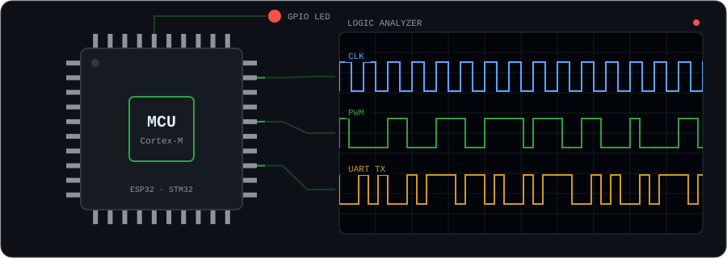

  

  

---

## 🧑‍💻 About Me

I am an Information Technology undergraduate with a strong interest in **embedded systems, electronics, and the Internet of Things (IoT)**. I enjoy working at the intersection of hardware and software, from programming microcontrollers and interfacing sensors to designing circuits and building connected devices that solve practical problems.

- 🔭 Currently strengthening my skills in **microcontroller peripherals, low-level firmware, and PCB design**
- 🌱 Learning **STM32 timers**, **digital design**, and **embedded C**
- 🤝 Open to **internships, research projects, and collaborations** in embedded and IoT domains
- ⚡ Fun fact: I like building things from first principles

---

## 🔌 Microcontrollers in Action

  

## 🚗 Automotive Embedded Systems

  

Working toward a career in **automotive embedded systems**: ECU firmware, in-vehicle networks (**CAN**, LIN), real-time control and sensor interfacing.

---

## 🛠️ Tech Stack

**Microcontrollers & Platforms**

**Languages**

**Hardware & Tools**

---

## 🚀 Featured Projects

| Project | Description | Tech |
|---|---|---|
| [**ESP32 Indoor Air Monitor**](https://github.com/LUCIFERMORNINGSTAR-HL/esp32-indoor-air-monitor) | Real-time indoor air-quality monitor with temperature, humidity, and gas sensing, plus live graphs on a 2.8" TFT display | ESP32 · DHT11 · MP-4 · TFT |
| **USB-C PD Breadboard** | USB-C Power Delivery powered breadboard with a variable voltage rail, designed in KiCad | STUSB4531 · LM338 · KiCad |
| **Pitwall** | ESP32-based F1 telemetry display | ESP32 · C++ |
| **IoT Botnet Detection** | Academic project on detecting IoT botnets using blockchain name-resolution and relay indicators | Python · Networking |

---

## 📊 GitHub Stats

  
  

---

## 📫 Connect With Me

<i>"Build it, break it, understand it."</i>

